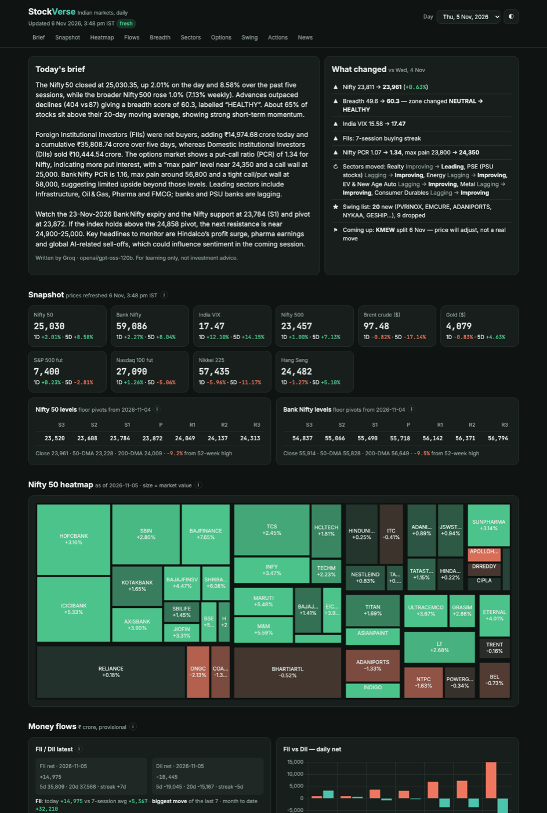

# Market Pulse India 📈

**A free, self-updating dashboard for the Indian stock market — built to learn how the market works.**
Every trading day it collects NSE data, news and flows, has an open-source AI model write a plain-English brief,
and publishes everything as a static website. No server, no subscription, no laptop left running.

**Live:** https://nishok-rajkumar.github.io/market-dashboard/



> For learning only. Nothing here is investment advice or a buy/sell recommendation.

## What's on the page

| Section | What it shows |
|---|---|
| **Today's brief** | ~150-word summary written by an open-source LLM (gpt-oss-120b / Llama on Groq) from the day's numbers and headlines |
| **What changed** | Nifty, breadth zone, VIX, PCR, sector quadrant moves and swing-list changes vs the previous session |
| **Snapshot** | Nifty, Bank Nifty, Nifty 500, India VIX, USD-INR, Brent, gold, US futures, Asia + floor-pivot levels |
| **Nifty 50 heatmap** | Every Nifty 50 stock grouped by industry, sized by market value, coloured by the day's change |
| **Money flows** | FII/DII cash flows with 20-session context and a calendar heatmap, **FII/DII/Pro/Client F&O positioning** (FII index-futures % long, 30+ sessions of history), delivery spikes, top movers, F&O ban list, results calendar |
| **Breadth** | 0–100 health score for the Nifty 500, % of stocks above 20/50/200-DMA, A/D, 52-week highs vs lows |
| **Sector rotation** | RRG-style rotation chart of 27 NSE sector indices with 4-week trails, plus Leading / Improving / Weakening / Lagging lists |
| **Options** | Nifty & Bank Nifty PCR, max pain, call/put OI walls, expected range to expiry |
| **Swing screener** | Minervini trend-template candidates with entry, stop, risk % and 2R target (study material) |
| **News** | ~200 headlines from 7 free RSS feeds, tagged by topic (RBI, FII, results, crude, rupee, sectors…) |
| **ⓘ explainers** | Every jargon term (PCR, max pain, breadth, RRG, delivery %, FII positioning…) explained in plain English |

## How it works

```
GitHub Actions (Mon–Fri)            data/<date>/*.json            GitHub Pages
 6:45 PM IST  full run   ───────▶   pulse, breadth, sectors, ───▶  site/ (static HTML + JS)
 8:30 AM IST  news + brief          options, swing, heatmap,       reads the JSON in the browser
                                    participant_oi, news, summary
```

- **Data:** NSE archives & public APIs, Yahoo Finance, public RSS feeds — all free, no API keys
- **AI brief:** Groq free tier (open-weights models); falls back to OpenRouter's free models, then to rule-based sentences
- **Resilient:** each step runs in its own process; a failing source only blanks its own section and the page says which
- **History:** each day is kept in `data/<date>/`, so you can open any past day from the date picker

## Run it yourself

1. Fork this repo (or use it as a template).
2. **Settings → Pages → Source: GitHub Actions**, and **Settings → Actions → General → Workflow permissions: Read and write**.
3. Get a free key at [console.groq.com](https://console.groq.com/keys) and add it as the repo secret `GROQ_API_KEY`
   (optional — without it the brief is written from rules).
4. **Actions → Daily market data → Run workflow.** Your site appears at `https://<you>.github.io/market-dashboard/`.

Locally (needs [uv](https://docs.astral.sh/uv/)):

```bash
uv run pipeline/run_daily.py
```

```bash
python3 -m http.server 8765
```

Then open http://localhost:8765/site/

| Path | What |
|---|---|
| `pipeline/run_daily.py` | Runs every step, writes `data/<IST date>/` and `status.json` |
| `pipeline/scripts/` | NSE pulse, breadth, sector rotation, option chain and swing screener scripts |
| `pipeline/participant_oi.py` · `heatmap.py` · `levels.py` · `news.py` · `summarize.py` | F&O positioning · Nifty 50 heatmap · pivots · headlines · AI brief |
| `pipeline/check_sources.py` | Shows which sources answer from the current machine |
| `state/` | FII/DII cash and participant-OI history (NSE only serves the latest day) |
| `site/` | The dashboard (`index.html`, `app.js`, `style.css`) |
| `.github/workflows/` | `daily.yml` (data + deploy), `pages.yml` (deploy on site edits), `check-sources.yml` |

## Ideas borrowed from

Looked at other open-source Indian-market projects for inspiration (ideas only, no code copied):
[PKScreener](https://github.com/pkjmesra/PKScreener) and [Screeni-py](https://github.com/pranjal-joshi/Screeni-py)
for screening and explaining results, and [fii-dii-data](https://github.com/MrChartist/fii-dii-data) for FII/DII context
and F&O positioning.

## Roadmap

- [ ] Daily brief to Telegram
- [ ] Install as a phone app (PWA)
- [ ] More scanners (52-week breakouts, NR7, golden cross)
- [ ] FII sector allocation (NSDL fortnightly data)

Contributions and ideas welcome — open an issue.

## License

Code is [MIT](LICENSE). Market data in `data/` and `state/` comes from NSE, Yahoo Finance and news publishers and
remains subject to their terms.

## Disclaimer

Data is provisional and may be delayed or wrong; sources can change or block access without notice. This project is
for education. It is not investment advice, and the author is not a SEBI-registered adviser.
